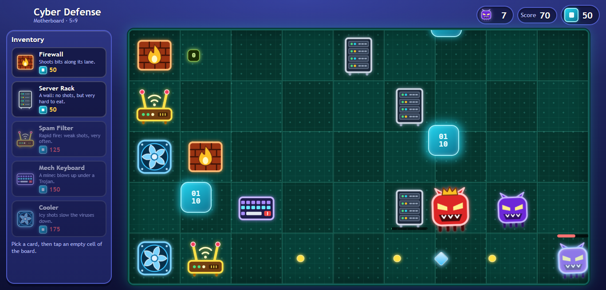

# Cyber Defense: Zero Day — Tower Defense on a Motherboard

[](https://6g9ip66h.idos.games/)
[](LICENSE)
[](https://solana.com)
[](https://colosseum.org)
[](https://idosgames.com/app/6G9IP66H/)

> A lane tower defense in the style of Plants vs Zombies where the battlefield is a motherboard — and where the **$ZDAY** token is never farmed and never sold: **holding** it in your Solana wallet is what unlocks tower skins and a head start.

[Live Demo](https://6g9ip66h.idos.games/) · [Video Walkthrough](#) · [Docs](docs/) · [Colosseum Submission](#)

---



---

## Submission to 2026 Solana National Hackathon

| Name | Role | Contact |
|------|------|---------|
| kyora1111 | Solo developer | [GitHub](https://github.com/kyora1111) |

---

## Problem and Solution

### 1. Play-to-earn faucets
- **Problem:** A game that pays out its token for playing gets farmed by bots, and a client-side web game cannot prove a run was honest — the server can only cap such a faucet, never verify it.
- **Cyber Defense:** $ZDAY is neither earned nor spent in the game. Viruses give score only. What counts is **holding**: 25, 50 and 100 $ZDAY in the wallet switch on two tower skins and a +20% start. No emission, nothing to farm.

### 2. A wall of transactions before the first second of play
- **Problem:** Connect, approve, deposit, pay gas — most web3 games lose the player before the game starts.
- **Cyber Defense:** One message signature signs you in (Phantom, Solflare). The game only *reads* the wallet's balance; playing never needs a transaction. Sign-in by e-mail works too — the hold rewards simply stay locked.

### 3. Token wrappers instead of games
- **Problem:** A clicker with a token attached is not a reason to come back.
- **Cyber Defense:** A real lane defense — five towers with distinct jobs, enemies that get tougher and faster with every arrival, a rare elite, runs of about three minutes and a global leaderboard of the best single run.

### 4. The backend eats the hackathon
- **Problem:** Auth, wallet sign-in, leaderboards, player data and hosting are weeks of work that have nothing to do with the game.
- **Cyber Defense:** All of it is the iDos Games platform, set up end to end through the **iDos Games MCP** by an AI coding agent — the time went into the game.

---

## Why Solana

- **Sign-in is a signature** — `signMessage` in Phantom or Solflare is instant and free; no transaction, no gas to start playing
- **One read tells the holding** — a wallet keeps a token on its associated token account, a deterministic address; the game derives it and reads the balance with a single `getAccountInfo` call
- **Cost** — an SPL token account and a few tokens cost cents, so "hold 25 $ZDAY for a skin" is a threshold anyone can reach
- **Ecosystem** — $ZDAY trades on a Meteora bonding curve right on the game's iDos Games page; the wallet that buys it is the wallet that plays

---

## Summary of Features

### The story
Your motherboard is the last clean machine on the network. Trojans crawl in along the traces from the right edge, lane by lane, each one tougher and sooner than the last — and one in twenty is an Elite Virus: red, crowned, three times as hard to kill. Data packets rain onto the board. Catch them, spend them on defenses, and hold the line: a single virus at the left edge takes the system down.

### The board
- A 5 × 9 grid — the "motherboard"; viruses walk their lane right to left
- Falling **data packets** are the run's only resource: +25 for each one caught, a new one every 4 seconds, 50 to start with
- A virus that meets a tower stops and eats it; one at the left edge is **Game Over**
- Every arrival has more health than the one before and comes sooner, so no defense holds forever and "the best score of a single run" means something

### Towers

| Tower | Price | What it does |
|-------|-------|--------------|
| **Firewall** | 50 | Shoots bits along its lane — only while a virus is in it. 20 damage every 1.4 s |
| **Server Rack** | 50 | A wall. Does not shoot; five times a Firewall's health (1500 vs 300) |
| **Spam Filter** | 125 | Rapid fire: three shots to a Firewall's one, each half as strong |
| **Mech Keyboard** | 150 | A mine. Blows up under the first virus that touches it and takes every virus in its cell with it |
| **Cooler** | 175 | Icy shots that barely hurt but cut a virus's walking speed by 50% for 3 s; another hit renews the chill, it never stacks |

### Viruses
- **Trojan** — 100 health, growing by about 7% with every arrival; 10 points
- **Elite Virus** — a 5% chance on every arrival, three times the health; 50 points

### $ZDAY — rewards for holding

| Holding | Reward |
|---------|--------|
| 25+ $ZDAY | **RGB Firewall** — a skin for the Firewall |
| 50+ $ZDAY | **Retro Keyboard** — a skin for the Mech Keyboard |
| 100+ $ZDAY | **Zero Day Holder** — +20% starting data packets and a badge in the lobby |

- $ZDAY is an SPL token on Solana mainnet: [`5HcLXTufXwi5B8vJH9RHd5Rz5jUtqs8D4CQQqq1idos`](https://solscan.io/token/5HcLXTufXwi5B8vJH9RHd5Rz5jUtqs8D4CQQqq1idos)
- Nothing to buy and nothing to claim: the game reads the signed-in wallet's balance every few minutes and switches the rewards on by itself
- A reward is a **timed boost** of the iDos Games title. It lasts an hour and is renewed while the wallet still holds enough — sell the tokens and the reward is gone within the hour
- The lobby's **Hold rewards** tab shows the wallet, what it holds and how far the next reward is

More in [docs/hold-rewards.md](docs/hold-rewards.md); the full rules of a run are in [docs/gameplay.md](docs/gameplay.md).

### iDos Games MCP integration
The project was built and shipped through the two iDos Games MCP servers, driven by an AI coding agent:

- **Code registry** (`@idosgames/mcp`) — the host shell (sign-in, lobby), the catalog modules (leaderboard, inventory, quests…) and the SDK skills the agent codes against
- **Title configuration** — everything the game needs on the live title was written section by section: sign-in by Solana wallet, the `best_run_score` leaderboard, the three timed boosts that carry the hold rewards, the RPC host the game may call inside the iDos frame
- **Publishing** — `begin_build_upload` → upload → `finish_build_upload` stages a build, and after a check of the staged version puts it live

The game itself is one module (`src/modules/cyber-defense/`) on that base.

---

## Tech Stack

| Layer | Technology |
|-------|-----------|
| Game client | React 19 · TypeScript (strict) · Vite 8 — DOM and inline SVG, no game engine, no image assets |
| Game logic | A pure reducer and a fixed-step simulation, no timers or randomness inside |
| Platform SDK | iDos Games — `@idosgames/core` · `react` · `app-shell` · `module-sdk` · `wallet` |
| Backend | iDos Games title: wallet sign-in, leaderboard, timed boosts, player data, hosting |
| Solana | SPL token ($ZDAY, mainnet) · sign-in by wallet signature (Phantom / Solflare via Reown AppKit) · JSON-RPC |
| Tooling | iDos Games MCP (code registry + title configuration) with an AI coding agent |

---

## Architecture

```
┌────────────────────────── browser ──────────────────────────┐
│                                                             │
│  iDos host shell (sign-in · lobby · tabs)                   │
│        │                                                    │
│        ▼                                                    │
│  cyber-defense module                                       │
│  ┌───────────────┐   ┌────────────────┐   ┌──────────────┐  │
│  │ game/         │◀──│ react/         │──▶│ components/  │  │
│  │ pure reducer  │   │ frame loop,    │   │ board, cards,│  │
│  │ + simulation  │   │ packet rain    │   │ hold rewards │  │
│  └───────┬───────┘   └────────────────┘   └──────────────┘  │
│          │ score, perks                                     │
│  ┌───────▼───────┐                        ┌──────────────┐  │
│  │ platform/     │───────────────────────▶│ chain/       │  │
│  │ session, hold │                        │ token account│  │
│  └───────┬───────┘                        └──────┬───────┘  │
└──────────┼───────────────────────────────────────┼──────────┘
           │ iDos SDK                              │ JSON-RPC
           ▼                                       ▼
┌──────────────────────────┐            ┌─────────────────────┐
│ iDos Games title         │            │ Solana mainnet      │
│ wallet sign-in           │            │ $ZDAY balance of    │
│ leaderboard · boosts     │            │ the wallet's token  │
│ player data · hosting    │            │ account             │
└──────────────────────────┘            └─────────────────────┘
```

- The match is client-side and deterministic: whoever drives it passes the time and the dice in with each action
- `platform/` is the only place the match meets the platform: a finished run's score goes out, the hold rewards come in
- `chain/` derives the wallet's associated token account and reads it; nothing in the game ever sends a transaction

See [docs/architecture.md](docs/architecture.md) for the full breakdown.

---

## Quick Start

**Prerequisites:** Node.js 20.19+ (or 22.12+), npm

```bash
# Clone the repository
git clone https://github.com/kyora1111/cyber-defense
cd cyber-defense

# Install dependencies
npm install

# Start the game — http://localhost:5180
npm run dev

# Check the types
npm run typecheck

# Build the static bundle into dist/
npm run build
```

No environment file is needed: the title the game talks to is baked into `src/idos.title.ts`, and a local run uses the live title.

---

## Roadmap

- [x] Core lane defense: the 5 × 9 board, data packets, Trojans, Game Over
- [x] Five towers: Firewall, Server Rack, Spam Filter, Mech Keyboard, Cooler
- [x] Elite Virus and pressure that grows with every arrival
- [x] Sign-in with a Solana wallet
- [x] Global leaderboard of the best single run
- [x] Rewards for holding $ZDAY: two tower skins and the Zero Day Holder start bonus
- [x] Published on iDos Games
- [ ] Holding verified by the server instead of read by the browser
- [ ] Wallet sign-in on phones (WalletConnect)
- [ ] More viruses, towers and designed waves
- [ ] More skins and hold tiers

---

## Resources

- [Live Application](https://6g9ip66h.idos.games/)
- [Game page on iDos Games](https://idosgames.com/app/6G9IP66H/) — the $ZDAY chart and trading
- [$ZDAY on Solscan](https://solscan.io/token/5HcLXTufXwi5B8vJH9RHd5Rz5jUtqs8D4CQQqq1idos)
- [Project Presentation — pitch video](https://youtu.be/JDMlpxAr3OQ)
- [Video Demo](#)
- [GitHub](https://github.com/kyora1111)

---

## License

MIT — see [LICENSE](LICENSE)
